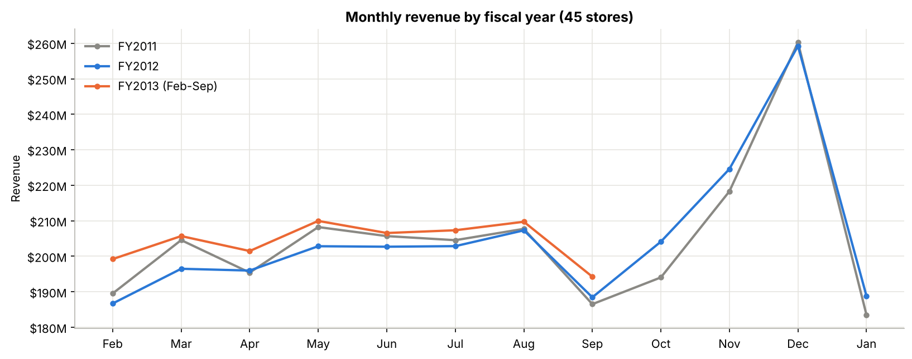
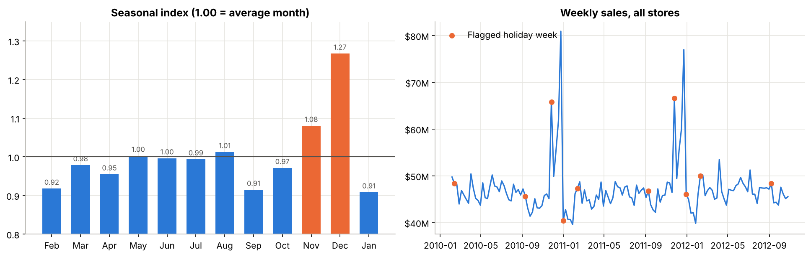
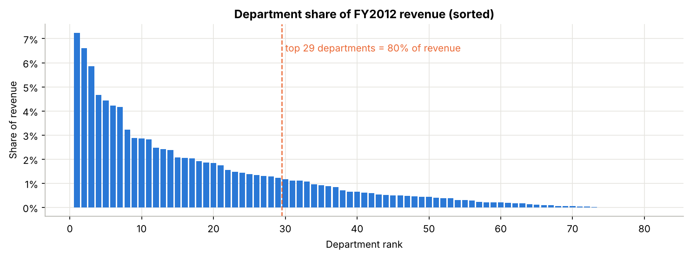
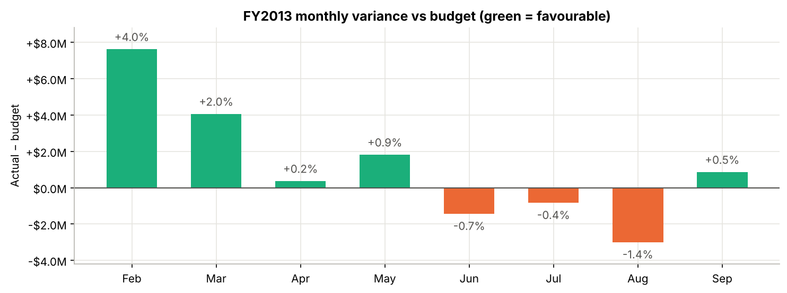
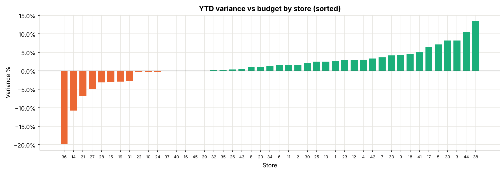
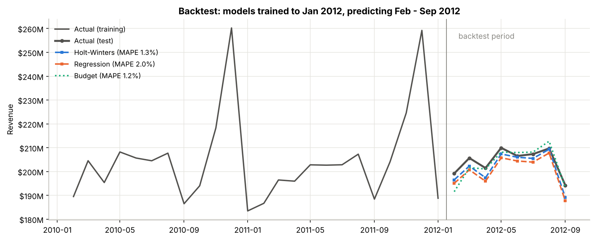
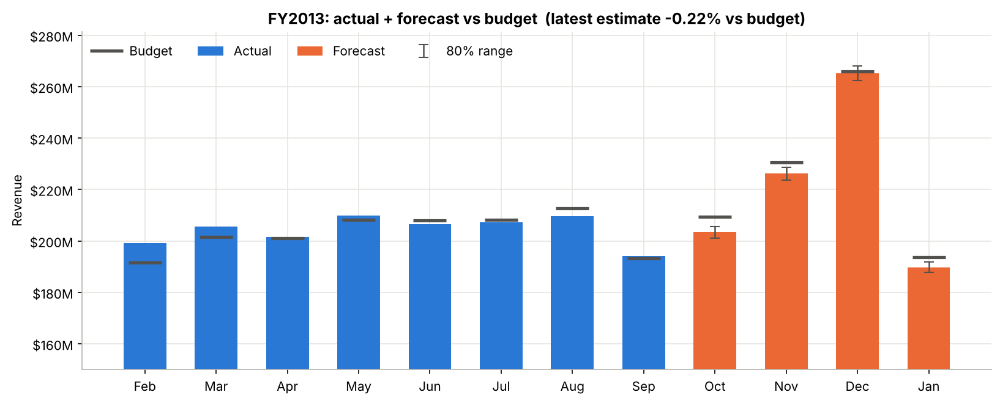

# Monthly Revenue Forecasting & Budget Variance Analysis
**Data Analyst Capstone · Real Walmart sales data · SQL · Python · Excel · Power BI**

## 1. Business problem
It is the start of **October 2012**. Walmart's finance team set a revenue budget for fiscal year 2013 (**Feb 2012 – Jan 2013**) for 45 stores. Eight months of actual sales are in, and the most important months of the year, the holiday season, are still ahead. Leadership asks:

1. **Are we on budget?** Which months, store types, stores and departments explain the gap?
2. **Where will the full year land?** Forecast Oct 2012 – Jan 2013 and compare the latest estimate with the budget.
3. **How far can we trust the forecast?** Which method would have been most accurate earlier in the year?

## 2. Data — real, not simulated
**Source:** [Walmart Recruiting – Store Sales Forecasting](https://www.kaggle.com/c/walmart-recruiting-store-sales-forecasting) (Kaggle, 2014). Real, anonymised weekly sales that Walmart released for this competition. See `data/source/SOURCE.md`.

| File | Rows | Contents |
|---|---|---|
| Weekly sales | 421,570 | 45 stores × 81 departments × 143 weeks (5 Feb 2010 – 26 Oct 2012), **$6.74 billion** in total |
| Stores | 45 | Type A (22 large), B (17 medium), C (6 small) and size in sq ft |
| Store-week features | 6,435 | Temperature, fuel price, CPI, unemployment, promotional markdowns, holiday flag |

**The one assumption:** Walmart's internal budget is not public, so the FY2013 budget is built the way many finance teams do it: **FY2012 actual for the same store, department and month × (1 + growth target)**, with targets **A 3.0%, B 2.0%, C 1.5%**. The targets can be changed in the Excel workbook. Everything else is real data.

### Data preparation (`scripts/01_prepare_data.py`, `sql/02_transform.sql`)
| Check / issue | Rows | What was done |
|---|---|---|
| `stores.csv` used old Mac line endings | 1 file | Converted |
| Negative weekly sales (returns larger than sales) | 1,285 | Kept (real returns) and flagged |
| Duplicates | 0 | None found |
| Store-department-weeks with no row | 99,665 | Treated as no sales (not every store has every department) |
| Markdown data missing before Nov 2011 | 4,140 store-weeks | Left blank. Walmart only supplied markdowns from Nov 2011, so they were not set to 0 |
| Feature rows after the last sales week | 1,755 | Removed |
| **Weeks straddle months** (Sat–Fri weeks) | – | Each week's sales were spread over its 7 days with a daily calendar, then summed by month. A check query confirms not a dollar was lost |
| Partial months (Jan 2010, Oct 2012) | – | Excluded, leaving **32 complete months: Feb 2010 – Sep 2012** |
| Walmart fiscal calendar | – | Fiscal year Feb–Jan, named by the year it ends (FY2013 = Feb 2012 – Jan 2013) |

## 3. Tools and workflow
```
 SQL                                Python                              Excel                               Power BI
 9-table database, weekly→monthly → trend, seasonality, budget        → budget vs actual workbook driven  → 5-page dashboard guide,
 allocation, budget built from      variance, 5 forecasting models,     by editable growth targets,         20+ DAX measures,
 assumptions, 22 queries            backtest, forecast + range          seasonal-index forecast             what-if growth slider
```

| Tool | Files | Highlights |
|---|---|---|
| **SQL** | `sql/01_schema.sql` … `05_forecast_queries.sql` | Keys and indexes; calendar join to allocate weeks to months; `INSERT … SELECT` to build the budget; 4 views; 22 queries with CTEs and window functions (`LAG`, `RANK`, `NTILE`, running `SUM() OVER`) |
| **Python** | `notebooks/revenue_forecasting.ipynb` | pandas, statsmodels (Holt-Winters, SARIMA, OLS); time-based backtest; forecasts written back into the SQL database |
| **Excel** | `excel/revenue_budget_variance.xlsx` | 13 sheets, ~1,900 live formulas: `SUMIFS`, `INDEX/MATCH`, `FORECAST`, `EOMONTH`, `RANK`, `LARGE`; editable growth targets; trading-day toggle; conditional formatting; charts |
| **Power BI** | `powerbi/POWER_BI_GUIDE.md` + `data/powerbi/*.csv` | Star schema, DAX for YTD / last year / variance / latest estimate, what-if parameter, theme (Tableau steps included for Mac users) |

---

## 4. Findings

### 4.1 Growth came back in 2012


| Fiscal year | Revenue | Growth |
|---|---|---|
| FY2011 (Feb 2010 – Jan 2011) | $2.458B | – |
| FY2012 (Feb 2011 – Jan 2012) | $2.460B | +0.07% (flat) |
| FY2013 Feb – Sep | $1.634B | **+3.22%** vs the same months last year |

### 4.2 Seasonality is strong and predictable


- **December is 27% above an average month**, November 8% above. January, February and September are about 9% below.
- The two biggest weeks are the **weeks before Christmas** (week ending 24 Dec 2010: **$80.9M**; 23 Dec 2011: $77.0M). Walmart's holiday flag does *not* mark them; it marks the Christmas week itself, which is slow. Flagged holiday weeks average only 7.8% above normal weeks.
- The pattern repeats almost exactly each year, which is why a last-year baseline works well (see 4.6).

### 4.3 Where revenue comes from
- **Type A stores (22) generate 64.5%** of revenue, but **small Type C stores sell the most per sq ft** ($605 vs $407 for Type A).
- Revenue is spread widely: **29 of 81 departments** make up 80% of sales.



### 4.4 Budget vs actual, year to date (Feb – Sep 2012)
| | Budget | Actual | Variance |
|---|---|---|---|
| **YTD** | $1,624.6M | $1,634.1M | **+$9.5M (+0.59%)** |



- **The leap day explains most of the lead.** February 2012 had 29 days, but the budget was built from a 28-day February. That extra day was worth about **$6.9M, 90% of February's $7.6M beat**. Without it, the YTD lead is only **+$2.6M (+0.16%)**. (Switch on "trading days" on the Excel `Assumptions` sheet to see this.)
- **Momentum has slowed:** Feb–May beat budget; **Jun, Jul and Aug all missed**.

| Store type | Growth target | Actual growth vs LY | Variance vs budget |
|---|---|---|---|
| A (22 stores) | 3.0% | +2.85% | **−0.15%** |
| B (17 stores) | 2.0% | +3.54% | +1.51% |
| C (6 stores) | 1.5% | +5.54% | +3.99% |



- **32 of 45 stores** are at or above budget; 3 stores are more than 5% behind.
- **Store 14 is $7.7M behind (−10.8%)**, almost as much as the whole company's YTD lead. Store 36 is the furthest behind in % terms (−19.9%).
- By department, Dept 92 is the biggest positive (+$6.1M) and Dept 72 the biggest negative (−$2.3M).
- **Promotions:** within each store, weeks with the biggest markdowns did **not** sell more than weeks with the smallest (sales index 0.995 vs 1.017).

### 4.5 Forecast models — tested on a backtest
Each model was trained only on Feb 2010 – Jan 2012 (what finance knew when setting the budget) and asked to predict Feb – Sep 2012. Models forecast **revenue per day**, so month length and the leap day are handled.

| Method | MAPE (avg. % miss) | Bias |
|---|---|---|
| Budget method (last year × growth target) | **1.23%** | −0.58% |
| **Holt-Winters** (damped trend, multiplicative season) | **1.27%** | −1.26% |
| Regression (trend + month effects) | 2.02% | −2.00% |
| Excel seasonal index × trend | 2.06% | – |
| SARIMA (1,0,0)(0,1,0)12 | 2.36% | −2.35% |
| Seasonal naïve (same month last year) | 2.71% | −2.71% |



- **Holt-Winters is the best statistical model**, and the simple budget method is just as good. For a stable retailer, last year is a strong baseline.
- **All models under-predicted** (negative bias). They were trained on a flat 2011 and could not know growth would return in 2012. Statistical forecasts need business judgment on top.

### 4.6 Full-year outlook: on budget, with Oct–Nov risk


| Month | Budget | Forecast (Holt-Winters) | Gap |
|---|---|---|---|
| Oct 2012 | $209.5M | $203.4M | −$6.1M |
| Nov 2012 | $230.5M | $226.2M | −$4.3M |
| Dec 2012 | $266.0M | $265.2M | −$0.8M |
| Jan 2013 | $193.7M | $189.8M | −$4.0M |

| Scenario | FY2013 latest estimate | vs $2,524.3M budget |
|---|---|---|
| **Cautious:** Holt-Winters (Oct–Jan +0.9% vs last year) | $2,518.7M (80% range $2,509M – $2,528M) | **−$5.6M (−0.22%)** |
| **Momentum:** each store keeps its YTD growth (+3.3%) | $2,539.9M | **+$15.6M (+0.62%)** |

- To hit budget, Oct–Jan must grow **+2.6%** on last year. YTD growth is +3.2%, so the budget is achievable, but only if the holiday season keeps the current pace.
- **Risk sits in Type A stores** (about −0.9% vs budget in the cautious case) and in a few stores: **Store 14 (≈ −$11.8M for the year), Store 27 (−$4.7M), Store 36 (−$3.8M)**.
- External factors add little: within each store, weekly sales barely move with fuel price, CPI or unemployment (|r| ≤ 0.07) and only weakly with temperature (−0.11).

---

## 5. Recommendations
| # | Recommendation | Evidence |
|---|---|---|
| 1 | **Budget on trading days** (revenue per day × days in month) | The leap day created a false $6.9M "beat" in February |
| 2 | **Close the October–November gap now** with pre-holiday promotion and staffing plans for Type A stores | Cautious forecast is $10.3M behind budget in Oct–Nov |
| 3 | **Store review for Stores 14, 27 and 36** | Together they are about $20M behind for the year |
| 4 | **Set growth targets from recent store performance**, not only store type | Type C beat a 1.5% target by growing 5.5%; Type A missed 3% |
| 5 | **Report a forecast range and update it monthly** (rolling forecast) | Two reasonable methods give −0.2% to +0.6% for the full year |
| 6 | **Re-evaluate markdown spend** | Bigger markdown weeks did not lift sales within stores |

---

## 6. Project structure
```
revenue_forecasting_capstone/
├── README.md                         ← this report
├── requirements.txt
├── data/
│   ├── source/                       ← original Walmart files (unchanged) + SOURCE.md
│   ├── clean/                        ← cleaned CSVs + cleaning_log.csv
│   ├── powerbi/                      ← model-ready files for Power BI / Tableau
│   └── revenue.db                    ← SQLite database (built by script 02; not on GitHub, too large)
├── sql/
│   ├── 01_schema.sql                 ← 9 tables, keys, indexes
│   ├── 02_transform.sql              ← weekly → monthly allocation, budget build
│   ├── 03_views.sql                  ← reporting views
│   ├── 04_analysis_queries.sql       ← 19 business questions
│   ├── 05_forecast_queries.sql       ← 3 forecast questions (run by the notebook)
│   └── query_results/                ← output of every query (CSV)
├── notebooks/revenue_forecasting.ipynb
├── excel/revenue_budget_variance.xlsx
├── powerbi/POWER_BI_GUIDE.md, theme/revenue_theme.json
├── images/                           ← charts used in this report
└── scripts/
    ├── 01_prepare_data.py
    ├── 02_build_database.py
    ├── 03_build_notebook.py (+ notebook_insights.json)
    └── 04_build_excel.py
```

## 7. How to reproduce
```bash
pip install -r requirements.txt
python scripts/01_prepare_data.py          # check and clean the original files
python scripts/02_build_database.py        # SQLite database, monthly allocation, budget, 19 queries
python scripts/03_build_notebook.py        # writes the notebook
jupyter nbconvert --to notebook --execute --inplace notebooks/revenue_forecasting.ipynb   # models + forecast queries
python scripts/04_build_excel.py           # Excel workbook (recalculates when opened in Excel)
```
SQL runs as written in SQLite (e.g. DB Browser for SQLite). Notes for PostgreSQL are at the top of each SQL file.

## 8. Limitations
- **The budget is an assumption**, not Walmart's real budget. The variance analysis shows the method; the targets can be changed in Excel.
- Walmart anonymised stores and departments, so there are no names or locations.
- 32 months is a short history for monthly models (only two full years to learn seasonality). Store-level forecasts therefore use a simple run-rate.
- The 80% forecast range comes from 8 backtest months, so it is indicative, not precise.
- Markdown data only exists from Nov 2011, so promotion findings cover about 11 months.

## 9. Portfolio / résumé bullets
- Built an end-to-end FP&A analytics project on **real Walmart sales data (421K weekly records, 45 stores, $6.7B)** using SQL, Python, Excel and Power BI.
- Designed a SQL database that allocates Sat–Fri weekly sales to calendar months with a daily calendar join and builds a store × department × month budget from assumption tables; wrote 22 analytical queries with CTEs and window functions.
- Found that **90% of a $7.6M February "beat" was the leap day**, leading to a trading-day budgeting recommendation.
- Backtested 5 forecasting models (Holt-Winters, SARIMA, regression, seasonal naïve); the best achieved **1.3% MAPE**, and its forecast put the full year within **−0.2% to +0.6%** of budget.
- Delivered an assumption-driven Excel budget-vs-actual model (~1,900 live formulas) and a Power BI dashboard design with 20+ DAX measures and a what-if growth parameter.
